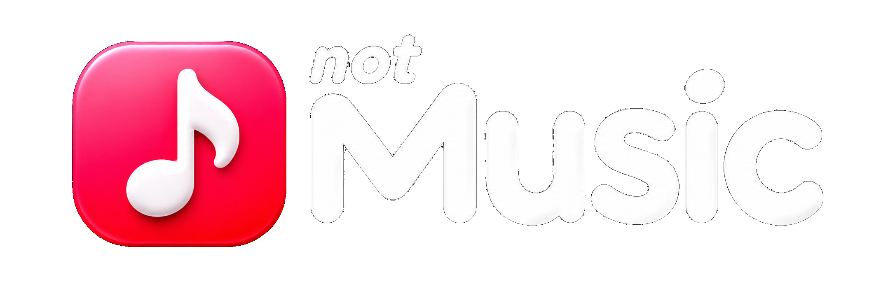
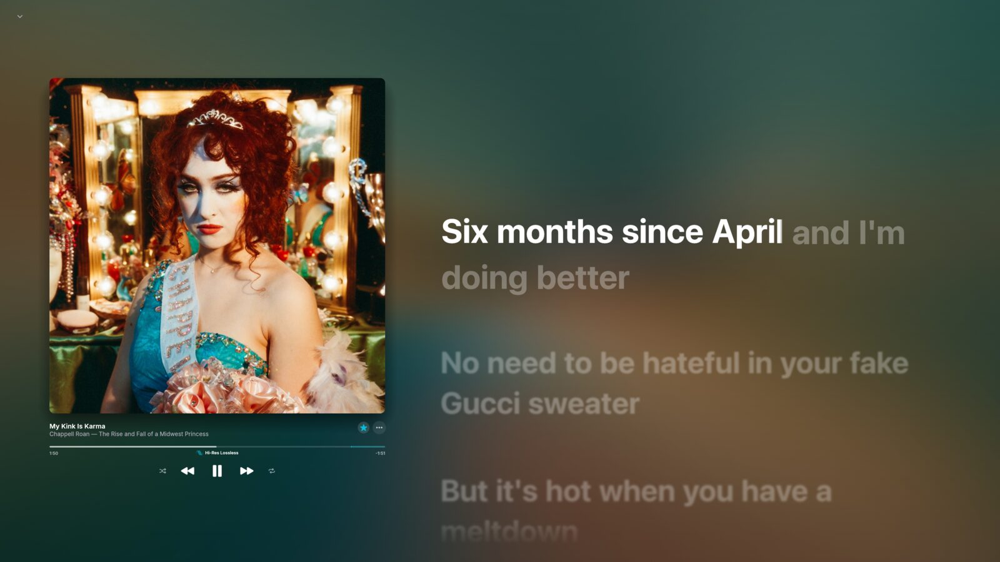

<div align="center">
  
  <p><strong>Not Apple. Not Spotify. Just Music.</strong><br>Independent by design. Music without the noise.</p>
  <p>A native music experience for macOS and iOS, built with Rust and Swift.</p>

  <p>
    <a href="https://github.com/fumakill4/notMusic/releases/latest"></a>
    <a href="https://github.com/fumakill4/notMusic/releases"></a>
    
    <a href="LICENSE"></a>
  </p>

  <p>
    <a href="https://discord.gg/cWQSGjpXM">Community</a> ·
    <a href="https://github.com/fumakill4/notMusic/releases/latest">Get notMusic</a> ·
    <a href="#what-it-can-do">Features</a> ·
    <a href="#run-notmusic">Install</a> ·
    <a href="#work-on-the-source">Source code</a>
  </p>
</div>

> notMusic is an independent, unofficial app. It is not affiliated with or endorsed by YouTube, Google, or Apple.

## Why the name notMusic?

notMusic is a playful parody of a familiar subscription music app. The name pokes fun at subscriptions that seem to keep getting more expensive, while the artwork reflects our reaction to a recent icon redesign that some listeners say they preferred in its earlier form. It's our creative take on the subject, not an official product or a statement on behalf of every listener.

## A look around

| Now playing | Browse music |
| --- | --- |
|  |  |

## What it can do

### Listen and manage playback

- Explore YouTube Music content, including tracks, albums, artists, playlists, mixes, radio and charts.
- Use shuffle, repeat, autoplay, queue controls, prefetching, volume normalization and output selection.
- Save supported tracks for offline listening.
- Crossfade between songs or let Automix choose a transition for the pair.
- Connect configured add-on sources for a higher-quality match, including lossless, hi-res or Dolby Atmos when available; YouTube audio remains the fallback.

### Make the player yours

- Follow time-synced lyrics, adjust their timing, and choose translation or romanization options.
- Keep playback controls in the player, tray and system media controls.
- Share a listening session with Listen Together, or connect Discord Rich Presence and Last.fm scrobbling.
- Sign in to access supported YouTube Music recommendations, playlists, likes, history and uploads.
- Move playlists and liked tracks from Spotify with the transfer tool.

The macOS desktop app and iOS app use native interfaces. Sign-in and selected integrations may open a system web view. Features that depend on external services or add-on sources work only while those services provide a compatible response.

## Get notMusic

Download the current [notMusic release](https://github.com/fumakill4/notMusic/releases/latest).

- **macOS:** open the Apple Silicon DMG and move notMusic to Applications.
- **iOS:** download the unsigned IPA and install it with your signing tool.

## Roadmap

- **Windows:** support is planned; no Windows build is available yet.

## Work on the source

Install Rust from [rustup.rs](https://rustup.rs/), then clone and build:

```sh
git clone https://github.com/fumakill4/notMusic.git
cd notMusic
cargo build --release
```

The executable is written to `target/release/`. macOS development may also need native audio libraries and components for sign-in or system integrations; see the development guides in this repository.

### Diagnostic logs

When reporting a problem, include the relevant log after removing tokens or other private data:

- **macOS:** `~/Library/Application Support/NotMusic/data/notmusic.log`

The previous run is retained as `notmusic.prev.log`. Sign-in helper processes write separate `notmusic-login.log`, `notmusic-spotify.log` and `notmusic-turnstile.log` files nearby.

## Project notes

- notMusic does not bypass subscriptions, DRM or regional restrictions.
- Hi-res and spatial-audio options depend on a configured source having a playable version of the selected track.
- YouTube Music, lyric providers, Discord, Last.fm, Spotify and other external services may change independently of this app.
- notMusic is distributed under [GPL-3.0](LICENSE); the project lineage and selected runtime components are credited below.

## Contributing

Bug reports and pull requests are welcome. For a useful report, include your OS, steps to reproduce, what you expected and the relevant redacted logs.

## Acknowledgements

- [Jacky Chan's BitChord PC Continued](https://github.com/jackychan4891/BitChord-PC-Continued) — the original PC application in this desktop project lineage.
- [LoserDenji's Bitchord Desktop Revived](https://github.com/LoserDenji/Bitchord-Desktop-Revived) — continued desktop development. The notMusic macOS DMG was adapted from their DMG package; its branding and contents were changed for notMusic.
- [egui](https://github.com/emilk/egui), [rodio](https://github.com/RustAudio/rodio) and Symphonia — interface and audio components used by this project.

notMusic is maintained by **Fumakill4** as an independent project. It is not an official BitChord build.
