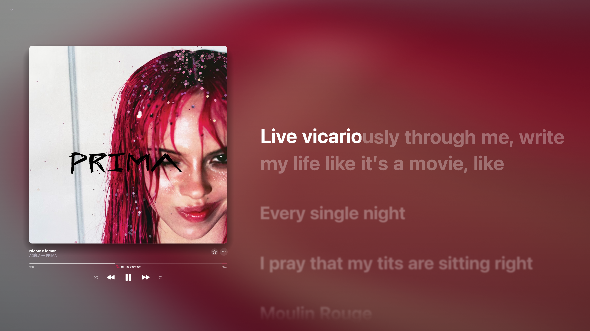
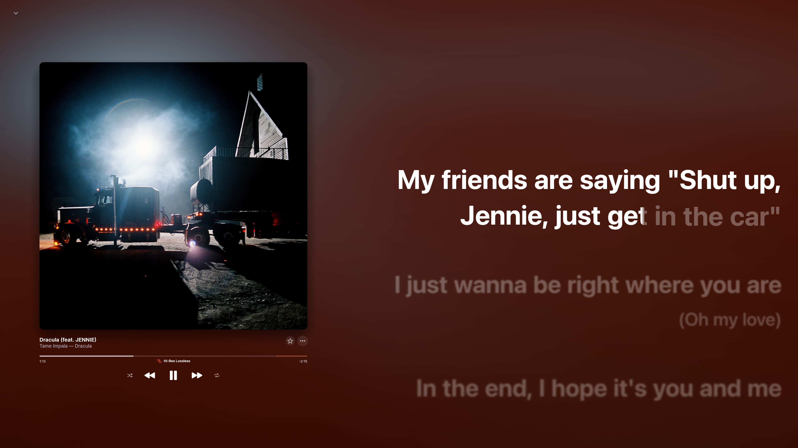

<div align="center">
  <h1>NotMusic</h1>
  <p><strong>Your music library and player, in a compact native desktop app.</strong></p>
  <p>NotMusic is written primarily in Rust, with an egui interface and rodio-based audio playback.</p>

  <p>
    <a href="https://github.com/fumakill4/NotMusic/releases/latest"></a>
    <a href="https://github.com/fumakill4/NotMusic/releases"></a>
    
    <a href="LICENSE"></a>
  </p>

  <p>
    <a href="https://discord.gg/cWQSGjpXM">Community</a> ·
    <a href="https://github.com/fumakill4/NotMusic/releases/latest">Get NotMusic</a> ·
    <a href="#what-it-can-do">Features</a> ·
    <a href="#run-notmusic">Install</a> ·
    <a href="#work-on-the-source">Source code</a>
  </p>
</div>

> NotMusic is an independent, unofficial client. It is not affiliated with or endorsed by YouTube, Google, or Apple.

## A look around

| Now playing | Browse your music |
| --- | --- |
|  |  |

<p align="center"></p>

## What it can do

### Listen and manage playback

- Explore YouTube Music content, including tracks, albums, artists, playlists, mixes, radio and charts.
- Use shuffle, repeat, autoplay, queue controls, prefetching, volume normalization and output selection.
- Save supported tracks for offline listening.
- Crossfade between songs or let Automix choose a transition for the pair.
- Connect configured add-on sources for a higher-quality match, including lossless, hi-res or Dolby Atmos when available; YouTube audio remains the fallback.

### Make the player yours

- Follow time-synced lyrics, adjust their timing, and choose translation or romanization options.
- Keep playback controls in the player, tray and system media controls.
- Share a listening session with Listen Together, or connect Discord Rich Presence and Last.fm scrobbling.
- Sign in to access supported YouTube Music recommendations, playlists, likes, history and uploads.
- Move playlists and liked tracks from Spotify with the transfer tool.

NotMusic's desktop interface and playback run natively. Sign-in and selected integrations may open a system web view. Features that depend on external services or add-on sources work only while those services provide a compatible response.

## Run NotMusic

Choose the newest installer for your operating system from [GitHub Releases](https://github.com/fumakill4/NotMusic/releases/latest).

- **macOS:** open the Apple Silicon DMG and move NotMusic to Applications. Intel builds are provided only when listed on the release.
- **Windows:** use the setup or portable archive attached to the release, then launch `notmusic.exe`.
- **Linux:** follow the package instructions attached to the Linux release.

If Windows warns that an unsigned build is unfamiliar, verify that you downloaded it from this repository's Releases page before choosing whether to run it.

## Work on the source

Install Rust from [rustup.rs](https://rustup.rs/), then clone and build:

```sh
git clone https://github.com/fumakill4/NotMusic.git
cd NotMusic
cargo build --release
```

The executable is written to `target/release/`. Platform-specific development can also need native audio libraries and components for sign-in or system integrations; see the platform guides in this repository.

### Diagnostic logs

When reporting a problem, include the relevant log after removing tokens or other private data:

- **Windows:** `%APPDATA%\NotMusic\data\notmusic.log` (portable builds keep `data` beside the executable)
- **macOS:** `~/Library/Application Support/NotMusic/data/notmusic.log`
- **Linux:** `~/.local/share/NotMusic/data/notmusic.log`

The previous run is retained as `notmusic.prev.log`. Sign-in helper processes write separate `notmusic-login.log`, `notmusic-spotify.log` and `notmusic-turnstile.log` files nearby.

## Project notes

- NotMusic does not bypass subscriptions, DRM or regional restrictions.
- Hi-res and spatial-audio options depend on a configured source having a playable version of the selected track.
- YouTube Music, lyric providers, Discord, Last.fm, Spotify and other external services may change independently of this app.
- NotMusic is distributed under [GPL-3.0](LICENSE); the project lineage and selected runtime components are credited below.

## Contributing

Bug reports and pull requests are welcome. For a useful report, include your OS, steps to reproduce, what you expected and the relevant redacted logs.

## Acknowledgements

- [Jacky Chan's BitChord PC Continued](https://github.com/jackychan4891/BitChord-PC-Continued) — the original PC application in this desktop project lineage.
- [LoserDenji's Bitchord Desktop Revived](https://github.com/LoserDenji/Bitchord-Desktop-Revived) — continued desktop development for macOS and Linux. The NotMusic macOS DMG was adapted from their DMG package; its branding and contents were changed for NotMusic.
- [egui](https://github.com/emilk/egui), [rodio](https://github.com/RustAudio/rodio) and Symphonia — interface and audio components used by this project.

NotMusic is maintained by **Fumakill4** as an independent project. It is not an official BitChord build.
